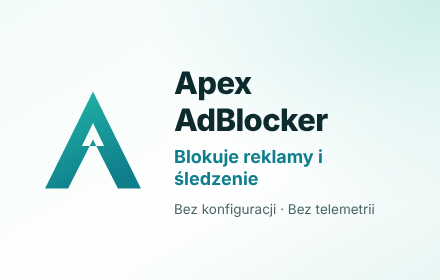
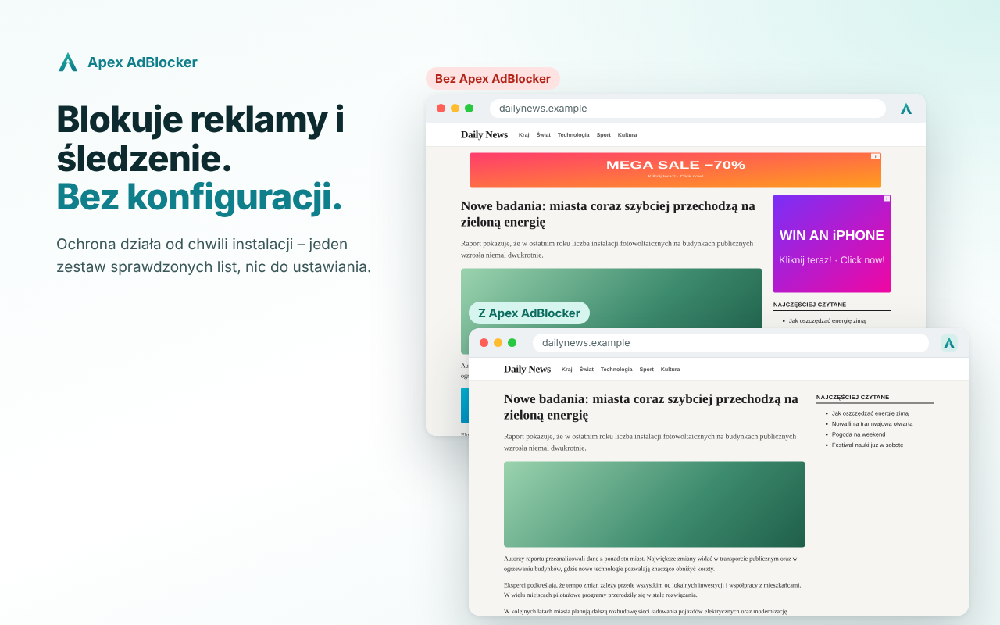
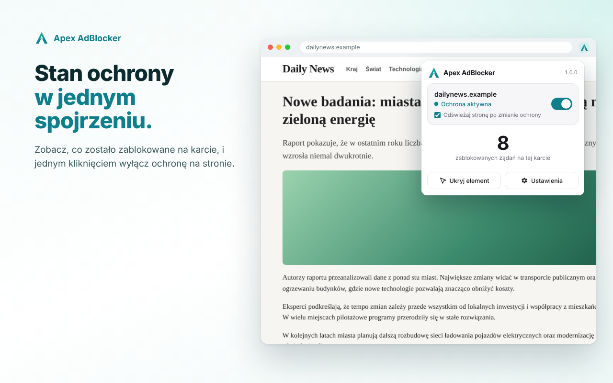
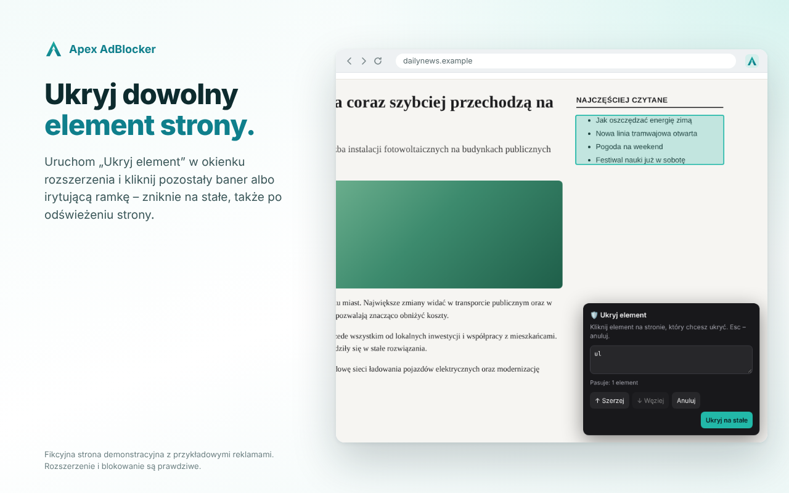
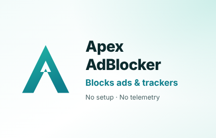
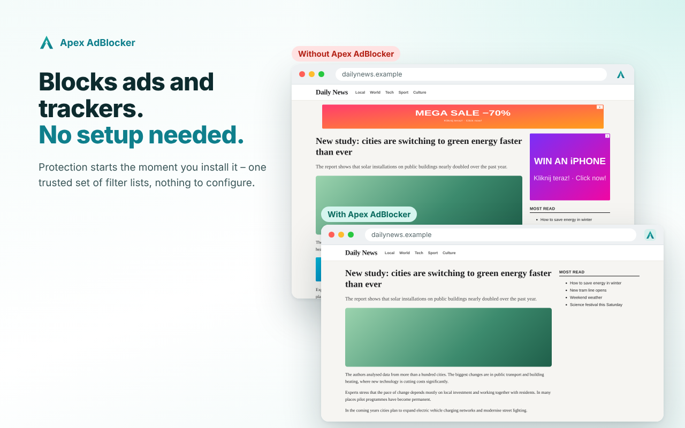

<p align="center">
  
</p>

<p align="center">
  Lekki bloker reklam i śledzenia dla Chrome · <a href="#eng">ENG ↓</a>
</p>

<p align="center">
  <a href="https://github.com/Bonziuu/Apex-AdBlocker/releases/latest"><b>⬇ Pobierz najnowsze wydanie</b></a>
</p>

<p align="center">
  
</p>

> **Status:** stabilne wydanie.

## Co robi

- 🛡️ **Blokuje reklamy, śledzenie i złośliwe strony** – od razu po instalacji
- ▶️ **YouTube Protection** – z kontrolą zgodności filtrów przy każdym wydaniu
- 🖱️ **Pełna kontrola** – wyłączanie ochrony na stronie jednym kliknięciem, „Ukryj element”, własne filtry
- 🔒 **Prywatność** – bez telemetrii, kont i serwera ([polityka prywatności](PRIVACY.md))
- 🌍 **Po polsku i po angielsku** – język według przeglądarki

<table>
  <tr>
    <td></td>
    <td></td>
  </tr>
</table>

## Instalacja

1. Pobierz `Apex-AdBlocker-<wersja>.zip` z [najnowszego wydania](https://github.com/Bonziuu/Apex-AdBlocker/releases/latest) i rozpakuj go w stałym miejscu na dysku.
2. Otwórz `chrome://extensions` i włącz **Tryb dewelopera**.
3. Kliknij **Załaduj rozpakowane** i wskaż folder `Apex-AdBlocker`.

Aktualizacja i usuwanie: [docs/INSTALLATION.md](docs/INSTALLATION.md).

## Dla programistów

```bash
npm install && npm test   # testy (Node.js 20+)
npm run check             # pełna kontrola, w tym test w Chromium
npm run package:release   # paczka dla użytkownika
```

Architektura, testy, packaging i ograniczenia: [docs/DEVELOPMENT.md](docs/DEVELOPMENT.md) · [opis techniczny](docs/technical-overview.md) · [materiały do Chrome Web Store](store/README.md)

## Listy filtrów

EasyList, EasyPrivacy, uBlock filters i Polskie Filtry – na warunkach ich licencji ([THIRD_PARTY_NOTICES.md](THIRD_PARTY_NOTICES.md)). Apex AdBlocker jest projektem niezależnym, niepowiązanym z Google, uBlock Origin ani autorami list.

---

<a id="eng"></a>

## ENG

<p align="center">
  
</p>

<p align="center">
  <a href="https://github.com/Bonziuu/Apex-AdBlocker/releases/latest"><b>⬇ Download the latest release</b></a>
</p>

<p align="center">
  
</p>

**Lightweight ad and tracker blocker for Chrome – no setup, no telemetry.**

- 🛡️ Blocks ads, trackers and malicious sites right after installation
- ▶️ YouTube Protection
- 🖱️ Turn protection off for a site with one click, “Hide element”, your own filters
- 🔒 No telemetry, accounts or servers ([privacy policy](PRIVACY.md))
- 🌍 English and Polish interface

**Install:** download `Apex-AdBlocker-<version>.zip` from the [latest release](https://github.com/Bonziuu/Apex-AdBlocker/releases/latest), extract it, open `chrome://extensions`, turn on **Developer mode**, click **Load unpacked** and select the `Apex-AdBlocker` folder.
