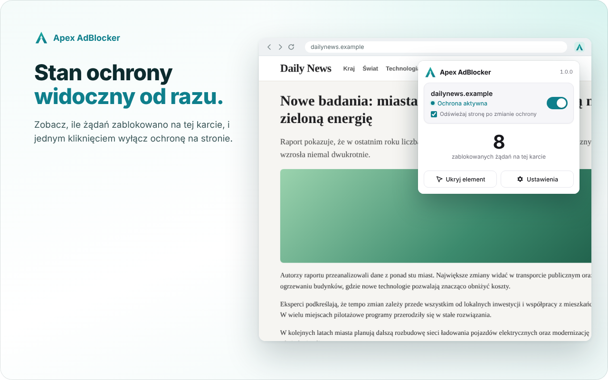
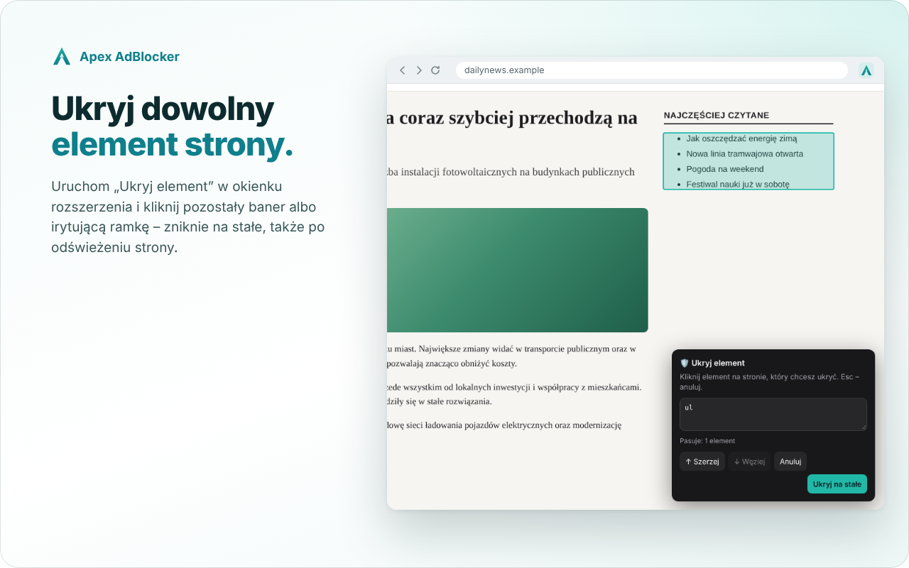
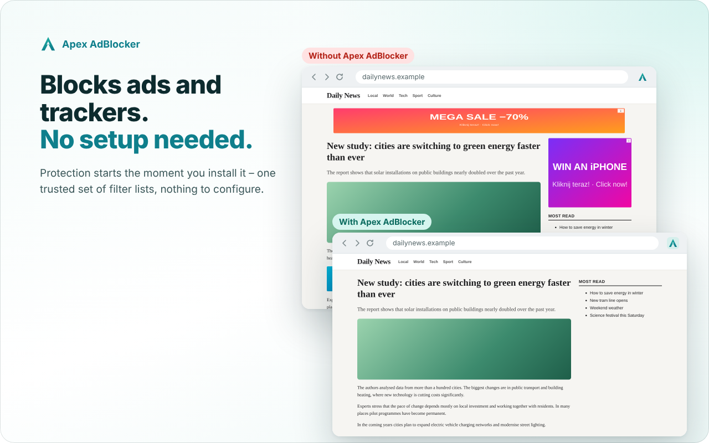

<p align="center">
  
</p>

<p align="center">
  Lekki bloker reklam i śledzenia dla Chrome · <a href="#eng">ENG ↓</a>
</p>

<p align="center">
  <a href="https://github.com/Bonziuu/Apex-AdBlocker/releases/latest/download/Apex-AdBlocker.zip"><b>⬇ Pobierz Apex AdBlocker (ZIP)</b></a> · <a href="https://github.com/Bonziuu/Apex-AdBlocker/releases/latest">wszystkie pliki wydania</a>
</p>

<p align="center">
  
</p>

> **Status:** kandydat do wydania; pełna walidacja obejmuje testy przeglądarkowe i rzeczywiste strony.

## Co robi

- 🛡️ **Blokuje reklamy, śledzenie i złośliwe strony** – od razu po instalacji
- ▶️ **YouTube Protection** – z kontrolą zgodności filtrów przy każdym wydaniu
- 🖱️ **Pełna kontrola** – wyłączanie ochrony na stronie jednym kliknięciem, „Ukryj element”, własne filtry
- 🔒 **Prywatność** – bez telemetrii, kont i serwera ([polityka prywatności](PRIVACY.md))
- 🌍 **Po polsku i po angielsku** – język według przeglądarki

<p align="center">
  
  
</p>

## Instalacja

1. Pobierz `Apex-AdBlocker-<wersja>.zip` z [najnowszego wydania](https://github.com/Bonziuu/Apex-AdBlocker/releases/latest) i rozpakuj go w stałym miejscu na dysku.
2. Otwórz `chrome://extensions` i włącz **Tryb dewelopera**.
3. Kliknij **Załaduj rozpakowane** i wskaż folder `Apex-AdBlocker`.

Aktualizacja i usuwanie: [docs/INSTALLATION.md](docs/INSTALLATION.md).

Strona projektu i pomoc w instalacji: https://apexsoftware.app/pl/adblocker/

## Dla programistów

```bash
npm ci && npm test   # testy (Node.js 20+)
npm run check -- --require-browser  # komplet testów bez SKIP oraz smoke Chromium
npm run package:release   # paczka dla użytkownika
```

Architektura, testy, packaging i ograniczenia: [docs/DEVELOPMENT.md](docs/DEVELOPMENT.md) · [opis techniczny](docs/technical-overview.md) · [materiały do Chrome Web Store](store/README.md)

Opis połączonych poprawek i wyniki walidacji: [docs/integration-fixes.md](docs/integration-fixes.md). Automat przygotowania zgłoszenia: `npm run webstore:prepare`.

## Listy filtrów

EasyList, EasyPrivacy, uBlock filters i Polskie Filtry – na warunkach ich licencji ([THIRD_PARTY_NOTICES.md](THIRD_PARTY_NOTICES.md)). Apex AdBlocker jest projektem niezależnym, niepowiązanym z Google, uBlock Origin ani autorami list.

---

<a id="eng"></a>

## ENG

<p align="center">
  
</p>

<p align="center">
  <a href="https://github.com/Bonziuu/Apex-AdBlocker/releases/latest/download/Apex-AdBlocker.zip"><b>⬇ Download Apex AdBlocker (ZIP)</b></a> · <a href="https://github.com/Bonziuu/Apex-AdBlocker/releases/latest">all release files</a>
</p>

<p align="center">
  
</p>

**Lightweight ad and tracker blocker for Chrome – no setup, no telemetry.**

Release candidate: complete browser and representative real-site validation is required before publication.

- 🛡️ Blocks ads, trackers and malicious sites right after installation
- ▶️ YouTube Protection
- 🖱️ Turn protection off for a site with one click, “Hide element”, your own filters
- 🔒 No telemetry, accounts or servers ([privacy policy](PRIVACY.md))
- 🌍 English and Polish interface

**Install:** download `Apex-AdBlocker-<version>.zip` from the [latest release](https://github.com/Bonziuu/Apex-AdBlocker/releases/latest), extract it, open `chrome://extensions`, turn on **Developer mode**, click **Load unpacked** and select the `Apex-AdBlocker` folder.

## Licencja

Własny kod i dokumentacja: MIT, © 2026 Konrad Woźniak. Dane third-party zachowują odrębne licencje. Zakres i warunki opcjonalnego wsparcia: [LICENSING.md](LICENSING.md).
