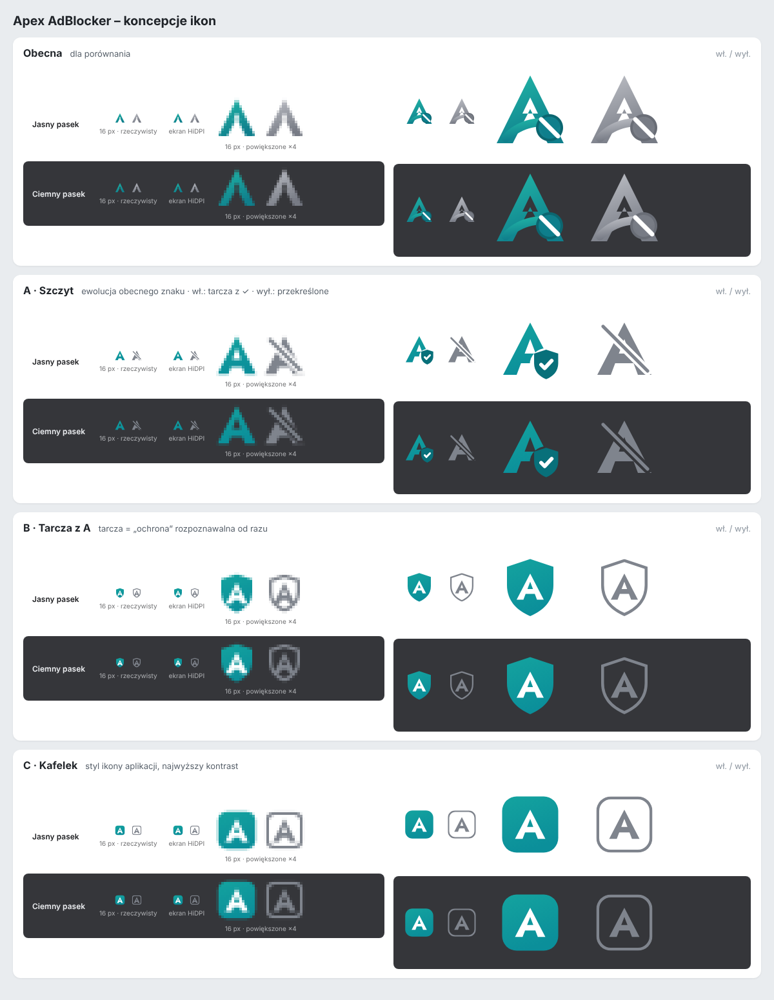

# Ikony Apex AdBlocker



Źródło wszystkich ikon: `tools/build-icons.mjs` (jedna funkcja `iconSvg` → `tools/icons/*.svg` i `icons/icon{16,32,48,128}[-off].png`).

```bash
npm run icons                  # domyślna koncepcja (B)
npm run icons -- --concept=A   # A „Szczyt” albo C „Kafelek”
```

## Koncepcje

| | Włączona ochrona | Wyłączona na stronie |
|---|---|---|
| **A · Szczyt** | litera „A”; od 48 px badge z tarczą i ptaszkiem | szare „A” przecięte ukośną kreską |
| **B · Tarcza z A** *(domyślna)* | wypełniona tarcza z białym „A” | pusta tarcza (kontur) z szarym „A” |
| **C · Kafelek** | zaokrąglony kafelek z białym „A” | pusty kafelek (kontur) z szarym „A” |

## Zasady

- **Stan widać po kształcie, nie tylko po kolorze.** Włączone = znak wypełniony, wyłączone = pusty lub przekreślony. Działa przy daltonizmie, na ciemnym pasku i w rozmiarze 16 px.
- **Kontrast ≥ 3:1** (WCAG dla elementów graficznych) na jasnym (`#ffffff`) i ciemnym (`#35363a`) pasku Chrome – pilnuje tego test `tests/tools/icons-theme.test.mjs`.
- **Bez przekreślonego kółka.** Symbol „zakazu” był nieczytelny i pokazywał „blokuję” nawet przy wyłączonej ochronie. Zastąpiła go tarcza (= „ochrona działa”).
- **16/32 px:** uproszczona litera z grubszymi nogami i większym otworem, bez detali, które przy tym rozmiarze znikają.
- **128 px (Chrome Web Store):** grafika ~96 px z 16 px przezroczystego marginesu, zgodnie z wytycznymi sklepu.
